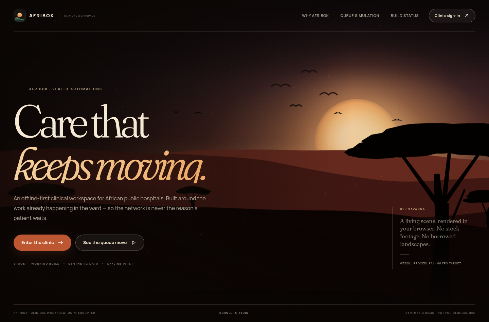

# Afribok — offline-first clinic workspace

**Live clinic deployment · clinical support is running**

App: **https://afribok.vertexsautomations.com** · workspace: **https://afribok.vertexsautomations.com/login**

Afribok is a clinical front-desk and patient-flow system: clinic email/password sign-in, local-first registration, returning-patient check-in, visits, duplicate safeguards, an offline outbox, idempotent sync, a role-scoped team and an audit trail — plus four clinical support features that run on Google Gemini:

| Feature | Where | What it does |
| --- | --- | --- |
| Paper record capture (OCR) | Register a patient → **Scan paper record** | Reads a photograph of a paper card or register page, returns every field with its own confidence plus warnings, and prefills the registration form for a person to confirm |
| AI triage | **AI triage** | Processes walk-ins in batches of 3–100, shows each patient's status live, saves each result on its own visit and escalates level 1–2 immediately |
| AI scribe | Patient record → **Record consultation** | Records the consultation in the browser (or takes a pasted transcript) and drafts a SOAP note that keeps what the patient said separate from what the clinician observed |
| Predictive engine | **Predictive engine** | Projects inflow, outflow, departmental demand, waiting time and staff workload with data quality and confidence on every card, plus hourly outflow detail |

The platform also includes Afribok's own EHR, an administrator-controlled EHR connector (FHIR R4 patient read and approved-note write-back with idempotency and conflict handling), a permission-aware AI Assistant, history import, a measured performance screen and department-scoped staff accounts.

Every AI output is a draft a staff member reviews, and each one is written to the visit and to the audit trail with the model name, time and author.

Before any clinical work, a new hospital answers eight setup cards: hospital information, departments, existing EHR/EMR status, historical data, patient volume and operations, staff accounts, and the technical environment. The answers are stored on the hospital's server and actually configure the workspace — the departments become the department options wherever staff are assigned, a paper-based hospital gets Afribok's own patient record, and the offline guidance follows the connectivity answer. The dashboard stays closed until an administrator completes the cards, and they can be edited later in **Hospital setup**.



## Start a real hospital

A fresh deployment has **no staff accounts and no patients**. Open **/register** and create the first account: it becomes the hospital administrator and is taken through the mandatory onboarding cards. Every later staff member is created by an administrator in **Team & roles** (name, staff number, role, department, contact and a temporary password) or can create an account at /register and be promoted by an administrator.

The live database currently has zero accounts and zero patient records. There are no shared demo passwords and no sample patients.

After sign-in, the workspace opens with no records; register the first walk-in to begin. The four operational workflows are **OCR & patient intake**, **AI triage**, **AI medical scribe** and the **Predictive engine**. The dashboard queue is sorted by recorded triage level, then waiting time.

## Status

### Working now

## Architecture

```
src/                 React 19 + Vite frontend
  pages/             landing, login, workspace pages (incl. outflow forecast)
  components/        triage panel, scribe panel, paper-scan dialog, shell UI
  scene/             three.js / react-three-fiber savanna and queue simulation
  lib/               IndexedDB mirror, outbox, sync engine, API + AI clients, audio capture
  workspace/         authenticated shell and live data context
server/              Express 5 API + SQLite
  app.ts             routes, security headers, login throttling
  setup.ts           onboarding profile, departments and the facility view
  ai.ts              /api/ai endpoints: OCR, triage, scribe
  platform.ts        /api/assistant, /api/ehr and /api/history: aggregate Assistant, audited integration status and CSV history
  gemini.ts          Gemini client with key rotation and cooldown
  forecast.ts        outflow forecast engine
  repository.ts      registration, duplicate checks, versioned updates, triage and notes
  auth.ts            sessions, permissions, password hashing
  seed.ts            first-start staff accounts (sample clinical data only for tests)
shared/              shared types, role permissions, duplicate matching, clinical contracts
tests/               API integration (incl. new platform routes), clinical AI (stubbed model) and queue-simulation tests
data/                runtime SQLite database (not committed)
```

### Local-first guarantees

1. A registration or visit change is written to IndexedDB and appended to an outbox before any network call.
2. Sync sends the outbox as a batch. Each operation carries a UUID; the server records it in `sync_operations`, so a retry returns the previous result instead of creating another record.
3. Strong duplicate candidates stop a write and return `conflict` candidates for human review. The server never auto-merges two patients.
4. Encounter updates require the client’s `baseVersion`. A stale copy becomes a `conflict` with the server’s current version, which staff can review in the Sync centre.
5. Audit events are recorded on the server for sign-ins, writes, sync outcomes, team changes and every AI action.

## Run locally

Requirements: Node 22+, npm. SQLite is bundled through `better-sqlite3`.

```bash
npm install
npm test                 # 36 tests: API integration, platform privacy/permissions, onboarding, clinical AI (stubbed), forecast, simulation
npm run typecheck
npm run build            # frontend, then server bundle
GEMINI_API_KEYS=... npm start   # PORT=3000 by default, serves dist + API
```

For frontend development with hot reload, run the API on port 3001 and Vite on 5173 (Vite proxies `/api`):

```bash
# terminal 1
npm run build:server
PORT=3001 GEMINI_API_KEYS=... AFRIBOK_DB=./data/dev.db node dist-server/index.js

# terminal 2
npm run dev
```

Environment variables:

| Variable | Default | Purpose |
| --- | --- | --- |
| `PORT` | `3000` | API / frontend port |
| `HOST` | `127.0.0.1` | bind address |
| `AFRIBOK_DB` | `./data/afribok.db` | SQLite database path |
| `COOKIE_SECURE` | unset | set to `true` behind HTTPS |
| `ALLOWED_ORIGINS` | unset | comma-separated extra origins for writes |
| `GEMINI_API_KEYS` | unset | one or more Gemini API keys, comma- or space-separated |
| `GEMINI_MODEL` | `gemini-3.5-flash-lite` | primary model for every clinical feature |
| `GEMINI_FALLBACK_MODEL` | `gemini-3.6-flash` | used when the primary model is unavailable |
| `NODE_ENV` | development | `production` for the deployed build |

The database is created and seeded on first start.

### How the clinic talks to Gemini

`server/gemini.ts` holds the key pool. Keys are used round-robin; a key that answers 429, 403 or a 5xx (or times out) is cooled down for a minute instead of being retried, and the request moves to the next key. If every key is cooling down the endpoint answers `429` with `AI_RATE_LIMITED` rather than failing silently. Nothing else in the product calls out to a network service.

## Deployment on this host

The live system runs under systemd and is reverse-proxied by Caddy:

- Service: `afribok.service` (`/etc/systemd/system/afribok.service`), running `/home/ubuntu/afribok/dist-server/index.js` as user `ubuntu` on `127.0.0.1:3000`.
- Service drop-in: `/etc/systemd/system/afribok.service.d/ai.conf` (mode 600) holds `GEMINI_API_KEYS`, `GEMINI_MODEL` and `COOKIE_SECURE=true`.
- Database: `/home/ubuntu/afribok/data/afribok.db`.
- Reverse proxy: `/etc/caddy/Caddyfile` terminates TLS for `afribok.vertexsautomations.com` and proxies to the app.
- Public URL: **https://afribok.vertexsautomations.com**

```bash
sudo systemctl status afribok
sudo journalctl -u afribok -n 100 --no-pager
sudo systemctl restart afribok
```

After changing code: `npm run build && sudo systemctl restart afribok`.

### Checks that run against the live deployment

```bash
bash scripts/live-fixtures.sh       # fake paper records + synthetic consultation audio
bash scripts/smoke-live.sh          # auth, bootstrap, sync, audit over HTTPS
python3 scripts/live-api-test.py    # API: OCR, triage, scribe, forecast with real Gemini
node scripts/live-ui-test.mjs       # browser: scan → prefill, triage click, scribe recording, forecast page
node scripts/live-signup-test.mjs   # browser: create an account, then sign in again on a fresh session
node scripts/live-setup-test.mjs    # browser: the hospital setup gate, all eight cards, stored answers
```

`scripts/live-ui-test.mjs` drives a real browser at 1440×1000, records audio through the fake device, and creates a disposable visit whose ids it writes to `/tmp/afribok-live/ui-patient.txt` so the test record can be removed afterwards. The API check leaves a `Chinwe Okonkwo` visit behind for the same reason.

## Limitations and pilot warnings

- **Clinical AI is not a medical device.** Triage levels, notes and forecasts are drafts. They need local protocol review, clinical validation, a supervised pilot and a measured baseline before they carry weight in care.
- **Clinical content leaves the clinic.** The presenting complaint, recorded consultation audio and photographed paper records are sent to the Google Gemini API. Data-protection review, patient consent and a data-processing agreement are prerequisites for real patient data.
- **Shared credentials.** The five accounts above are working accounts for this deployment with a published password. Individual people should create their own account at **/register** (or be provisioned in Team & roles) and the published password should be rotated before real use.
- **Single-node SQLite deployment.** Fine for one facility; it is not a horizontally scaled multi-tenant deployment.
- **No backup, monitoring or retention policy is configured** in this build. Take a copy of `data/afribok.db` before changing clinical settings.
- **The forecast is a planning aid.** Arrival patterns come only from this clinic’s own record; with under 90 days of history it blends conservative defaults and says so. It is not a measured hospital baseline.
- **The queue simulation is illustrative.** Registration and consultation times are inputs chosen to show the workflow, not a forecast or evidence of impact.
